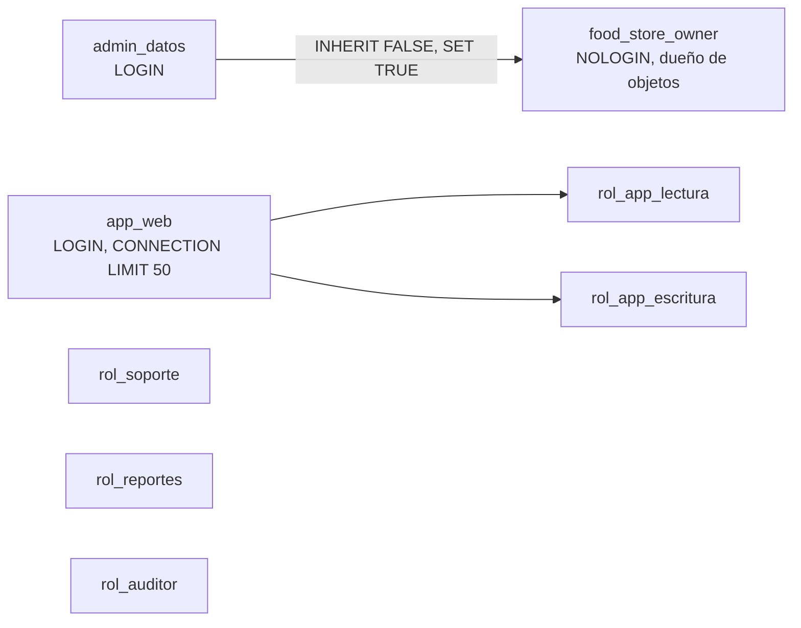

# Design Document

## Overview

> Versión 2 (ver `requirements.md`).

El diseño separa tres capas: **propiedad** (`food_store_owner`, sin login), **privilegios** (roles de grupo `NOLOGIN`) e **identidades** (roles `LOGIN` que solo reciben membresías). Así, revocar o rotar una credencial no toca la política, y auditar la política se reduce a revisar los roles de grupo.

## Architecture

`rol_soporte`, `rol_reportes` y `rol_auditor` no tienen login asignado en el laboratorio: se otorgan a personas concretas cuando existan (por ejemplo `GRANT rol_soporte TO op_soporte_1`).

## Matriz de privilegios (fuente de la verificación)

| Rol | Objeto | Privilegio | Requisito | Justificación (una oración) |
|---|---|---|---|---|
| food_store_owner | todos los objetos de `public` | dueño | R1 | Concentra DDL y la identidad de las funciones `SECURITY DEFINER` en un rol que nadie puede usar para conectarse. |
| rol_app_lectura | categoria, producto, cliente, pedido, detalle_pedido | SELECT | R2.1 | La tienda muestra catálogo y el historial de compras del cliente, nada más. |
| rol_app_lectura | usuario (id_usuario, nombre, apellido, email, rol, activo) | SELECT por columna | R2.2 | La aplicación muestra el perfil del usuario sin necesitar su hash, teléfono ni estado de bloqueo. |
| rol_app_escritura | cliente, pedido, detalle_pedido | INSERT | R3.1 | Registrar compras y clientes. |
| rol_app_escritura | cliente (nombre, apellido, email, telefono, deleted_at); pedido (forma_pago, deleted_at); detalle_pedido (cantidad, deleted_at) | UPDATE por columna | R3.1 v2 | La app corrige datos y hace bajas lógicas, pero no puede reasignar un pedido a otro cliente ni cambiar precios ya cobrados. |
| rol_app_escritura | producto (stock) | UPDATE por columna | R3.2 | Al vender solo cambia el stock; precio, nombre y categoría los mantiene administración. |
| rol_app_escritura | fn_autenticar(text, text) | EXECUTE | R3.3 | El login valida contra el hash dentro de la función, sin dar lectura de `password_hash`. |
| rol_soporte | usuario (todas menos password_hash) | SELECT por columna | R4.1 | Soporte necesita ver si una cuenta está activa o bloqueada, nunca el hash. |
| rol_soporte | usuario (activo) | UPDATE por columna | R4.2 | Habilitar o deshabilitar una cuenta es la única modificación directa que atiende soporte. |
| rol_soporte | fn_resetear_password(bigint, text) | EXECUTE | R4.3 | El reseteo pasa por una función que exige longitud mínima, desbloquea y deja rastro. |
| rol_reportes | categoria, producto, pedido, detalle_pedido | SELECT | R5.1 | Los reportes de ventas no necesitan identificar personas. |
| rol_reportes | usuario_anon | SELECT | R5.2 | Para métricas de usuarios se usa la versión anonimizada (Parte D). |
| rol_auditor | auditoria_acceso | SELECT | R6 | Quien investiga lee el registro, pero no puede alterarlo. |
| app_web, admin_datos, rol_soporte, rol_reportes, rol_auditor | base de datos | CONNECT | R8.1 v2 | Solo las identidades previstas (o miembros de esos grupos) pueden conectarse. |
| roles de grupo | esquema public | USAGE | R8.2 | Necesario para resolver nombres; `CREATE` no se otorga a nadie salvo el dueño. |

Todo lo que no figura en la matriz está denegado. En particular: nadie salvo el dueño tiene `DELETE`, `TRUNCATE`, `REFERENCES`, `TRIGGER` ni `CREATE`.

## Decisiones de diseño

1. **Membresía de `admin_datos` sin herencia (PostgreSQL 16: `WITH INHERIT FALSE, SET TRUE`).** Las operaciones de dueño requieren `SET ROLE food_store_owner`, que queda explícito en la sesión y en el log.
2. **pgcrypto en el esquema `extensiones`.** Permite revocar `EXECUTE` a `PUBLIC` en `public` sin romper `crypt()` / `gen_salt()`, que solo usa el dueño desde las funciones `SECURITY DEFINER`.
3. **`SET search_path` fijo en cada función `SECURITY DEFINER`.** Evita que un llamador cree un objeto con el mismo nombre en un esquema que se resuelva antes.
4. **Política de tablas futuras (v2).** Las tablas y secuencias nuevas del dueño nacen sin privilegios para otros roles (`ALTER DEFAULT PRIVILEGES ... REVOKE ALL ... FROM PUBLIC`) y las rutinas nuevas sin `EXECUTE` para `PUBLIC`. Así heredan la misma política que este script: nada se otorga sin justificarlo. La v1 otorgaba `SELECT` automático a `rol_app_lectura`; la auditoría con IA señaló que una tabla futura con datos personales quedaría expuesta, y se aceptó la corrección.
6. **Límites de sesión en `app_web` (v2).** `statement_timeout` e `idle_in_transaction_session_timeout` acotan el daño de una consulta abusiva o de una transacción abierta; se fijan en el rol de login porque `ALTER ROLE ... SET` no se hereda.
5. **Sin contraseñas en el repositorio.** `roles.sql` crea los logins sin contraseña; el script de ejecución las fija con `log_statement` desactivado en esa sesión para que no queden en el log.

## Testing Strategy

- `\du` para atributos y membresías.
- Consulta "esperado `EXCEPT` real" y "real `EXCEPT` esperado" sobre `information_schema.role_table_grants`, `column_privileges` y `routine_privileges`: ambas deben devolver 0 filas.
- Pruebas funcionales con `SET ROLE`: cada rol ejecuta una operación permitida (debe funcionar) y una prohibida (debe fallar con `insufficient_privilege`).
